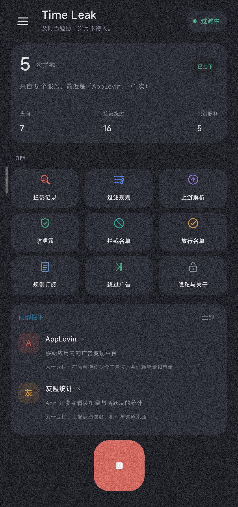
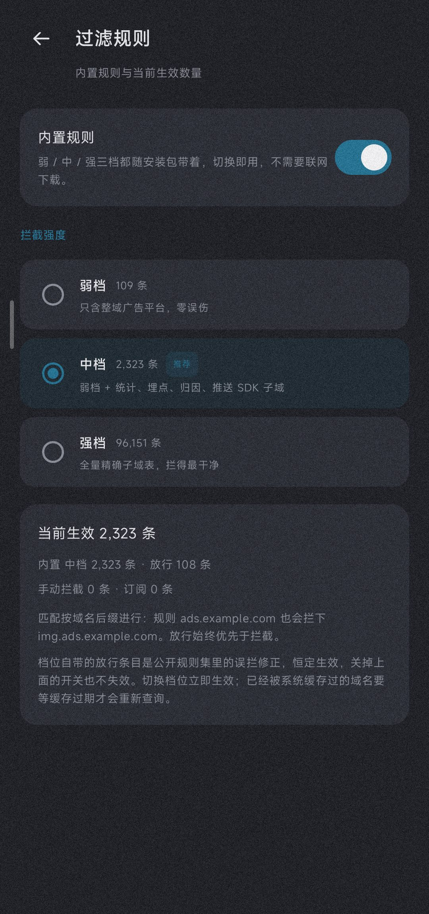
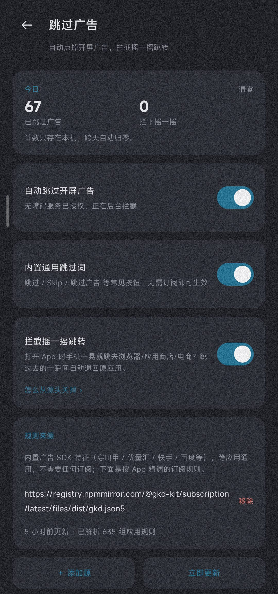
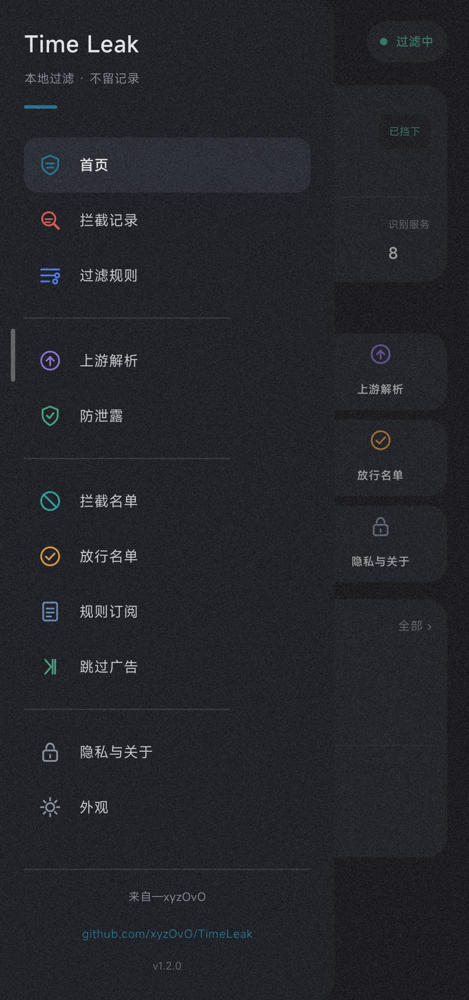
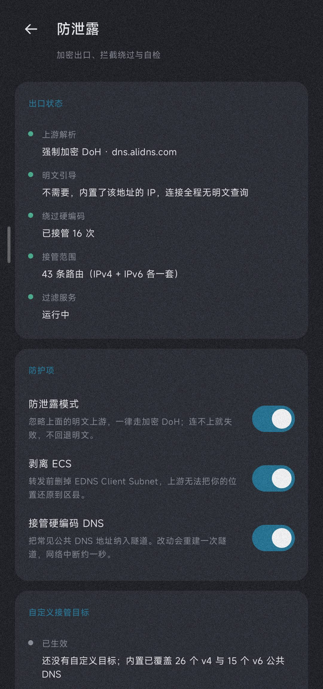

# Time Leak

**Lightweight DNS-only filtering plus out-of-the-box splash-ad skipping.**
Open-source Android tool · No account · No server · No tracking

> [!WARNING]
> **Time Leak is and will always be free and open source.** If you paid for it anywhere, you were scammed — request a refund immediately. Any paid build is a re-packaged fraud and has nothing to do with this project.

> [!NOTE]
> Licensed under **MIT**; keep the copyright notice when reusing code. This is a **personal Android app** with no affiliation, partnership, or authorization from any ad platform or app store. Platform names are used only to identify sources. The **app UI is Chinese only**; this English README is documentation only.

📲 [Download](#-download) · ✨ [Features](#-features) · 🖼 [Screenshots](#-screenshots) · 🎯 [Rules & Tiers](#-rules--tiers) · 🛠 [Build](#-build) · ❓ [FAQ](#-faq) · 🧩 [How it works](#-how-it-works) · ⚖️ [Privacy & Compliance](#-privacy--compliance) · 📄 [License](#-license)

---

## 📲 Download

> **Requirements**: Android 8.0 (API 26) or above. The APK is a properly signed release build; allow "install from unknown sources" on first install.

- Download `app-release.apk` from **Releases** (signed, install and run).
- Or build it yourself (see [🛠 Build](#-build)).

Two steps after install, or features won't work:

1. **Allow the VPN permission**: enabling filtering shows a "connection request" — accept it. This is how DNS filtering works (DNS only, no full-traffic tunneling).
2. **Enable the accessibility service**: toggle it on the "Skip Ads" page, then enable "Time Leak 跳过广告" in system accessibility settings. Splash-ad skipping depends on it.

> For background uptime: disable battery optimization and whitelist the app for autostart / background run (especially on MIUI / ColorOS / HarmonyOS).

---

## ✨ Features

### 🔎 DNS filtering

| Feature | Description |
|---|---|
| **DNS only** | A VpnService redirects system DNS to local resolution; no full-traffic tunneling, minimal overhead |
| **Local resolve + encrypted upstream** | Domain matching and resolution happen locally; encrypted upstream with ECS stripping by default; no query logs on disk |
| **Three built-in tiers** | Weak / Medium / Strong ship inside the APK; switch in the "Filter Rules" page, no download needed |
| **Anti-misfire allowlist** | Built-in allowlist always wins, so system probes / push domains aren't blocked by accident |
| **Optional subscriptions** | Import public subscriptions (e.g. GKD official) as supplements — not required |
| **Honest status** | When the service is off, VPN isn't granted, or rules are loading, the UI says why |

### ⏭ Splash-ad skipping

| Feature | Description |
|---|---|
| **Out of the box** | Built-in skip-button fingerprints of major ad SDKs (Pangle, GDT, KSAd, Baidu, …) work on install |
| **Online subscription** | Ships one GKD official subscription covering splash-skip rules for hundreds of common apps |
| **Active polling** | Splash ads often render after the launch transition and emit no accessibility event, so the service polls windows actively |
| **Five anti-misfire gates** | Time window resets only on external entry, narrow-control constraint, click de-dup, text whitelist, CTA / deny-word blacklist |
| **Late skip buttons** | The explicit-signal pass covers the full 12s splash window, so "Skip / Close" buttons appearing after a countdown or lazy ad rendering are still found; any corner, not hardcoded to top-right |
| **Ad-type classification** | Distinguishes splash, promo popups, in-feed ads, rewarded videos and paid/download ads; the latter three plus anything unrecognized are never clicked |
| **Pre-click re-verification** | Right before acting, the node is re-read: still present, still visible, bounds not drifted (±16px), text unchanged, window still owned by the same app — any mismatch aborts the click and records why |
| **Per-app policy** | Presets plus per-package overrides, see below |
| **Shake landing-page rollback** | Without root we can't block sensors; we only roll back "jumped to browser/store/shop" landing pages, max once per target / 10s |
| **Idle backoff** | After several rounds where nothing was actually clicked, the event-merge window widens from 120ms up to 480ms; a click or a window change pulls it back at once. The signal is "did anything get clicked", not "were there candidates" — a splash-ad screen always yields a few narrow candidates, so keying off candidates meant the backoff never kicked in on exactly the screens that needed it |
| **System UI never scanned** | Launchers, system search (`com.android.quicksearchbox` and friends), wallpaper pickers, IMEs and installer screens are skipped outright. Launcher package names aren't hardcoded — they're resolved from `PackageManager` at startup, so a different ROM keeps working |
| **Launcher-transition retry** | When an app is cold-started from the launcher, the event already carries the app's package while the active window is still the launcher. That round used to be dropped entirely (19 drops in one real test run, most of them here); now it's re-scanned once after 180ms, at most 3 times |
| **Visible scan cost** | Every "scan heartbeat" entry records how long that scan took, split into "tree X · match Y" — so it's obvious whether the cost is cross-process node reads or rule matching |
| **Tree read off the main thread** | Reading the node tree (`rootInActiveWindow` plus every node property) is all cross-process calls — 2~645ms per scan. It used to run on the accessibility main thread, where the message queue piled up to 3 seconds and this process dropped over a hundred frames, which is why clicks felt slow. It now lives on a dedicated thread; the main thread keeps matching and clicking (2~4ms measured). On the same ad screens, no main-thread long task from this process shows up any more |
| **Clicked ≠ skipped** | A successful click action only means the control accepted the gesture — it says nothing about whether the screen changed. So 600ms later (plus an 800ms grace) the target is re-checked: is it still visible, did the window / activity / package advance? Only then is the skip counted; otherwise the click is rolled back, that control is blacklisted for 6 hours, a rescan fires at once, and the toast never claims "skipped" |
| **Sibling fallback** | When a text candidate turns out dead, its parent container is searched for a "clickable, text-less, narrower than 45% of the screen" icon and that is clicked once — some apps make the real button an icon with no label, while the labelled "Skip ad 1/2/3" next to it do nothing |
| **Text-less button guess** | Some ads paint the skip button straight onto the canvas: no text, no id, so text matching never reaches it. When every text round has failed, the window fills the screen and the screen still carries ad wording ("click to jump / landing page / third-party app"), one candidate is guessed by "clickable + in a top corner + small", at most once per splash window. It still goes through every gate, the pre-click re-check and the post-click verification; turn it off in settings if it ever guesses wrong |
| **Guessing only on full-screen windows, top corners only** | Floating notifications, bubbles and small windows raise window events too and land in the same 12-second splash window; without an area check the floating button inside them passes for a skip button (two false positives on a real device, one record each in two apps that carry no ads at all). The window root is measured first: anything below 80% of the screen is never guessed on, and even the evidence pass is skipped. Candidates are also limited to the two top corners — the small icons along the bottom-left are floaters, bubbles and tabs, not skips |
| **Full evidence in the log** | Observation rows used to show only the last 4 reasons, which cut off the heaviest one (geometric guess, +56) — so "82" sat next to 26 points of reasons and looked arbitrary. All reasons are listed now (folded past 8) together with the total score |
| **Deep text pass** | Some full-screen ads are drawn by a WebView: the hotspot wording ("click to jump", "landing page", "third-party app") sits 19~20 levels deep, while the normal walk stops at 12 — so the evidence was never read and the screen never looked like an ad. When corner candidates exist but no ad evidence was found, one text-only deep pass runs (depth 24, 400 nodes, 120ms caps), so the normal path costs nothing extra |
| **Remembered target** | Up to 64 control ids whose click was verified go into an LRU; next launch the node is fetched by id instead of walking the whole tree (measured 120~160ms → 7~20ms). The fetched node still faces every score, gate and re-verification; if the remembered id was just blacklisted, it falls back to a full scan |
| **Fake-button veto** | A candidate that isn't clickable itself, whose only clickable ancestor covers more than half the screen, is rejected outright as a fake button inside a full-screen ad hot zone. Such targets score high, so subtracting points is not enough |
| **Candidate ranking** | With several candidates on one screen the order is "clickable itself > smaller area > closer to a screen corner", replacing the old "take the first one the walk happens to hit" |
| **Splash merge cap** | The splash window backs off too, capped at 240ms (the very first scan is still immediate — 7~14ms to first click measured). Feed-style apps emit eight content events per second, which used to produce close to a hundred scans inside a 12-second splash window, none of them with a candidate |

Per-app policies are edited on the "Skip Ads" and "App rules" pages; **explicit user settings win over presets and auto-classification**:

| App | Default policy |
|---|---|
| Taobao / Tmall / JD | Splash only, no shopping popups |
| Douyin / Douyin Lite | Explicit splash buttons only (no subscription inference, no coordinate taps) |
| Toutiao / Tencent News / NetEase News | Splash + closing promo popups |
| Alipay / UnionPay / CCB / ICBC, plus anything whose package or label looks like banking / payments / government | Never auto-click |
| Everything else | Splash + promo popups with explicit ad signals (default) |

Promo popups are handled only with an explicit ad signal, a policy that allows them, and no user interaction in the last 900ms — at most once per app session. Multiple close candidates on one screen are treated as an in-feed list and skipped entirely.

### 🧩 App rules

The "App rules" page keeps per-app switches, tiers and lists in one place:

| Capability | Description |
|---|---|
| **Installed-app list** | Queried via `ACTION_MAIN + CATEGORY_LAUNCHER`, so the full launcher list shows up even on Android 11+; search by label or package |
| **Per-app switch** | Turning it off only stops the acting; the chosen tier is kept, so re-enabling needs no re-picking |
| **Per-app tier** | Four levels: never auto-click / explicit splash buttons only / splash only / splash + promo popups |
| **Protected list** | Highest precedence: no auto-click and no shake rollback — suited to banking, government and IME apps |
| **Recently used** | Keeps the last 8 foreground packages for quick rule tweaks; package names only, no in-app behaviour |
| **Import / export** | A dedicated "app rules" JSON: packages, tiers, off-list and protected list only — no subscriptions, DNS config or records |

**Per-app DNS exceptions are not possible, and the UI says so instead of pretending.** Time Leak only takes over DNS; Android resolves through the system, so "which app issued this query" is unavailable. Per-app network blocking has the same problem: this version takes no default route and carries no full traffic. To allow a domain, use the "Allow list" — it works by domain, applies to every app, and is the most direct fix for a false positive.

### 🛡 Leak protection

| Feature | Description |
|---|---|
| **Public DNS via tunnel** | 23 common public DNS servers are added to the tunnel route as `/32`; non-virtual-DNS 53 packets are taken over |
| **Cleartext DNS takeover** | Non-virtual-DNS 53 packets are taken over; 443 / 853 are dropped to prevent bypass |
| **Self-built DoH socket** | DoH uses a hand-built socket for SNI + cert validation, bypassing system resolution to avoid local DNS leaks |
| **Private DNS avoidance** | Reads the system "Private DNS" state and avoids conflicting with it |

### 🔄 In-app updates

| Feature | Description |
|---|---|
| **Manual check** | Triggered from "Check for updates" in the side drawer or the button at the bottom of the "Privacy & About" page; only connects when you tap, never in the background |
| **Multi-source fallback** | Version info is fetched concurrently from `update.json` in the repo (raw / jsDelivr) and the GitHub Releases API, then the highest version wins; downloads retry across mirrors |
| **Signature check** | The downloaded APK's signature is compared with the installed one before installing; a mismatch blocks it, keeping out repackaged unofficial builds |
| **You decide** | Once downloaded, the system installer takes over — you confirm the install |

> Maintainers releasing a new version should sync three places: ① `versionCode` / `versionName` in `app/build.gradle.kts`, ② `version` / `notes` in the repo-root `update.json`, ③ replace `app-release.apk` and update the Release. If they disagree, the app picks the highest version so an update is never missed.

### 📋 Domain explanations in the block log

The block log does more than list domains — it explains who owns each one, what it does, and why it was blocked. Explanations come from four layers and are **generated entirely from local tables**:

| Layer | Content | Basis |
|---|---|---|
| Manually verified | Common ad / analytics services, with company and purpose | Public documentation; each card shows its own "Source" line |
| Vendor domain families | Subdomains under registrable domains such as Tencent, Baidu, Alibaba and Microsoft | Registrable-domain ownership is public; per-subdomain purpose is marked "not individually verified" |
| Upstream dispute labels | PCDN, in-app encrypted DNS and carrier auto-login from anti-AD `discretion/` | Upstream lists. These are **not ads** — the card explains the real reason and the possible side effects |
| Name / shape inference | Random-looking domains, or names containing `ad` / `stat` / `log` | Pure string matching, explicitly labelled "inferred, unverified"; no company is invented |

Switching tiers, toggling built-in rules or refreshing subscriptions syncs the "From" line on cards and the "currently active rules" note at the bottom. Existing cards keep the list that was active when they were hit rather than claiming a source that was never in effect. No lookup ever leaves the device: nothing is uploaded, and no query history is sent anywhere.

> Maintainers: after updating rules or subscriptions, re-run the explanation generator so descriptions follow the new rule set:
> `python tools/explain/build_catalog.py` (add `--offline` to use only cached upstream lists).
> It regenerates `GeneratedCatalog.kt` and writes `tools/explain/unknown_families.txt` —
> domain families still without an explanation, ranked by rule count. Verify ownership,
> add it to `tools/explain/seed.tsv`, then run the generator again.
> **Never invent a company for a random domain with no public ownership data** — leave it to the inference layer.
> When adding entries, also register any special subdomains of a broad suffix (e.g. `yximgs.com`)
> as their own, more specific rows: longest-suffix matching otherwise lets the parent description
> win, and an `-ad` ad subdomain would be described as a content CDN.

### 📊 Overview & self-check

The Overview page shows eight metrics: ads blocked today, DNS queries today, splash skips, DNS blocks, current running state, most recent skip, allowed domains, and rule-hit sources. All counters are bucketed per calendar day and reset automatically.

> Wording: in a DNS-only architecture "ads blocked today" and "DNS blocks" are the same number (every query answered locally with NXDOMAIN). "Allowed domains" counts **distinct domains explicitly matched by an allow rule**, capped at 5000. The most recent skip stores only time, package, rule and verdict — never the button text.

Self-check covers eight items: VPN permission, DNS service, accessibility permission, accessibility service liveness, battery optimization, rule loading, subscription updates, and a DNS connectivity test. Each failure offers the matching fix: re-authorize, try service recovery, open system settings, re-enable the service, disable battery optimization, show the load error, show the failure reason, or run the resolver test.

**Recovery has hard limits**: at most 3 attempts per 30 minutes, at least 60s apart; missing VPN/accessibility permission only produces a hint and **never opens a system permission dialog automatically**; only this app's DNS foreground service is restarted; a user-initiated stop or revoke never triggers recovery. Boot restore is off by default, and the foreground notification shows live state plus today's query/block counts.

### 🔬 Observation mode, scoring & offline regression

Ad skipping moved from "keyword hit = click" to **multi-condition scoring**: ad-SDK view ids, explicit text, scoped subscription rules, narrow controls, short labels, corner position, clickability, splash window and countdown digits add up; wide controls, long text, soft evidence and out-of-window context subtract; business CTAs / deny words, rewarded videos, paid ads, in-feed ads and anything unrecognized are hard-vetoed.

| Confidence | Behaviour |
|---|---|
| High (≥70) | Auto-click only if ad type and per-app policy both allow |
| Mid (45–69) | Log only, or upgrade once when the same target reappears shortly with stronger evidence |
| Low (<45) | No action |

**Safe observation mode** (a core feature) recognizes rules without clicking or pressing Back. Each record shows the current app, text, id, clickability, rule, verdict, score, ad type, action and scoring reasons; switch back to auto-execution once the rules look right. Observation records live **in memory only**, vanish on process exit, and are never persisted, backed up or uploaded.

The page also keeps a **scan heartbeat**: every scan leaves one line (app, node count, candidate count, window phase, verdict) whether or not anything matched. When the record list is empty it tells you which of the cases you hit — no node tree, empty tree, no candidates, merged because you switched apps too fast, or blocked by policy — without attaching a PC to read logcat. Heartbeats are memory-only too, capped at 40, and store structural data plus how long the scan took, never on-screen text.

A successful click starts a **2-second cooldown**: no second target in the same window, re-evaluated only after a window change. Node-tree scanning filters irrelevant events, merges content changes within 120ms, scans only on window/content changes, and caps depth 12 / candidates 300 / visited 400 / 120ms timeout with a short-lived plain-data snapshot. `AccessibilityNodeInfo` instances are released together at the end of each scan and never cached across scans.

**Troubleshooting** is not just a "running" label. Two chains carry concrete answers: when an ad wasn't skipped, "Why it wasn't skipped" on the observation page states the app, target, confidence tier and where it stopped (policy off / observation mode / weak evidence / cooldown / re-verification found the page changed), keeping at most 20 entries in memory; when a site won't open, the self-check page shows the most recent blocked domain, its type and rule origin, and points to the allow list and upstream settings — the two places that actually change the outcome.

Maintainers can run **offline rule regression on a PC**, no device needed:

```bash
python tools/regression/run.py
```

It compiles `DecisionModel.kt` + `DecisionCore.kt` (the very same decision core used at runtime) together with typical node-tree samples from `tools/regression/samples.json` into JVM bytecode using the Kotlin compiler in the Gradle cache. It asserts correct hits, no false hits on normal buttons, no duplicate clicks, no action after page switches, correct clicks after countdowns, and no cross-app side effects. The report goes to `tools/regression/report.txt`; a failure returns a non-zero exit code.

The matching layer (`SkipEngine`) has its own **timing benchmark**, also PC-only:

```bash
powershell -ExecutionPolicy Bypass -File tools/bench/run-bench.ps1   # tools/bench/run-bench.sh in bash
```

It runs the real `SkipEngine` over a fixed sample of 300 nodes × 340 rules in 45 groups, reporting medians for `safety check / built-in fingerprints / subscription matching` plus microseconds per node. Run it after touching matching code to see whether the cost actually dropped or merely moved.

### 🔐 Subscription safety & privacy audit

**Public subscriptions are never trusted unconditionally.** Every update goes through: source allowlist (new sources need explicit user confirmation) → SHA-256 fingerprint → diff preview (added/removed counts and samples) → anomaly checks → user confirmation → one-tap rollback to the previous version. Blocking anomalies include script fragments, `file://` references, over-long lines, empty rule sets, a sudden surge of allow rules, and a >50% rule-count drop; such updates never become active automatically. GKD and DNS lists share the same gateway.

The parser itself assumes it is fed bad data: a malformed or half-downloaded subscription could previously send the parse loop spinning in place and occupy the single hot-reload thread forever, silently killing every later rule update. Loops now always advance, nesting beyond 64 levels is abandoned outright, and the worst case is "this subscription didn't load".

The Privacy Audit page lists every local storage item, every network endpoint, the permission list, DNS encryption state and VPN traffic scope; it offers config backup/restore (plain JSON, configuration and lists only), one-tap runtime-data clearing, full local-data clearing (with confirmation) and subscription integrity checks. Backups exclude subscription bodies, block logs, observation records and statistics.

> The VPN only adds the virtual DNS and public-DNS `/32` routes to the tunnel — there is no default route. App traffic never passes through this service, which is also why per-app query attribution is impossible.

---

## 🖼 Screenshots

| Home | Filter Rules (tiers) | Skip Ads |
|---|---|---|
|  |  |  |

| Drawer (GitHub entry) | Leak protection |
|---|---|
|  |  |

---

## 🎯 Rules & Tiers

Built-in rules come in **Weak / Medium / Strong** tiers, all inside the APK; switch in the "Filter Rules" page. Subscriptions are supplements, not required.

| Tier | Block rules | Allow rules | Use for |
|---|---|---|---|
| Weak | 109 | 110 | Only the most annoying ads; almost no false blocks |
| Medium | 2,324 | 110 | Daily recommendation; covers most ads & trackers |
| Strong | 96,151 | 110 | Aggressive; may break niche apps, allowlist as needed |

> On a false block, add the domain to the allowlist on the "Filter Rules" page, or drop to a lower tier.

The default subscription is a single GKD official feed (`@gkd-kit/subscription` dist) covering splash-skip rules for hundreds of common apps. You can add other sources; updates happen only when you tap, never in the background.

---

## 🛠 Build

Requires **JDK 17** and **Android SDK** (compileSdk 35).

```bash
# Standard (needs to fetch the Gradle wrapper)
./gradlew assembleRelease

# If the wrapper can't download, use a local Gradle 8.9 offline
JAVA_HOME=/path/to/jdk17 gradle assembleRelease --offline --no-daemon
```

Output: `app/build/outputs/apk/release/app-release.apk`. The repo's release builds use a fixed signing key, so upgrades are direct overwrite installs.

---

## ❓ FAQ

**Q: No internet after enabling filtering?**
A: Confirm the VPN permission is granted. If you set a system "Private DNS", the app reads and avoids it — don't force both. Strong tier is very aggressive and may over-block; switch to Medium or add an allowlist entry.

**Q: Splash skipping doesn't work / keeps mis-clicking?**
A: It needs the accessibility service. In system Settings → Accessibility, confirm "Time Leak 跳过广告" is on. On MIUI / some ROMs, battery saver freezes accessibility (shows bound but does nothing in `dumpsys`); re-enable it in settings and set battery strategy to "Unrestricted".

**Q: Why DNS-only, not a full proxy?**
A: The app's scope is lightweight filtering + splash skipping. DNS-only already covers most ad/tracker domains with minimal overhead and no full-traffic handling. Per-app blocking is reserved as an extension point.

---

## 🧩 How it works

- **DNS-only VpnService**: a `10.225.0.1` tunnel with virtual DNS `10.225.0.2`; system DNS is redirected locally, matched by domain suffix, the rest resolved normally. Virtual DNS and tunnel must be on different addresses or the local route table creates a `scope host` shortcut.
- **Leak protection**: 23 public DNS servers added as `/32` to the tunnel route; non-virtual-DNS 53 packets taken over, 443 / 853 dropped. DoH must build its own socket (`Socket → bind → protect → connect`) for SNI + cert validation; one wrong step and "DoH times out → whole network loses resolution".
- **Splash skipping**: the accessibility service watches window events and actively polls windows for ~12s after an external entry; scanning goes in three rounds — ad-SDK resource names → user coordinates → text whitelist. At most 2 clicks per window and only the same control, text only on narrow + short controls, plus a CTA / deny-word blacklist to avoid misfires.
- **Matching cost**: selector values are lowercased and regexes compiled once at load time; during a scan each node's text is lowercased once and reused across hundreds of rules (previously every clause lowered it again, and `contains(ignoreCase = true)` folds case position by position). When the subscription contains no `[name=]` selector, `className` isn't even read, saving one cross-process call per node. On the benchmark sample, match time went from 83.7µs to 17.1µs per node.
- **Tree reader thread**: `rootInActiveWindow` and every node property are cross-process calls costing 2~645ms, so they run on a dedicated `SkipScan` thread; the main thread only matches, gates and clicks (2~4ms). Before reading, system windows, this app and policy-disabled apps are rejected without reading the tree at all. The click path is unchanged and still on the main thread.
- **Battery**: DNS counters no longer push a UI refresh for every packet — at most one per 250ms plus a trailing emit (no value lost, UI at most 250ms behind), and the date check runs at most once a second; on the scan side, the merge window backs off to 480ms while idle. The DNS read loop blocks in `poll` instead of busy-waiting.
- **Effect verification**: a click returning `true` only means the control accepted the action. So "clicked" and "skipped" are two separate states — 600ms later the target is looked up by viewId again, and the window / activity / package are compared; if nothing moved, the click counter is rolled back and the control is blacklisted. Stats, toast and memory all hang off "verified", never off "clicked".
- **Memory and fallback**: verified control ids go into a 64-entry LRU and are fetched by id next time; dead candidates go into a 6-hour blacklist and the same container is searched for a text-less narrow icon. Both still require a real node and every gate — no rule is relaxed.
- **Geometric guess**: a skip button drawn on a canvas has neither text nor id — only position and size identify it. It is a separate last resort with four conditions, all required: inside the splash window, the window fills the screen (≥80%, so floating notifications and small windows never qualify), the screen really shows ad wording ("click to jump / landing page / third-party app" — not "tap to view", which is everywhere), and every earlier round failed. Candidates must be clickable, sit in a top corner and stay under 20% of the width — the mirror image of the "a clickable ancestor covering the whole screen is a decoy" rule. On by default, switchable under "Tap & recognition"
- **Who was spinning**: one real v1.4.0 test run did 99 full-tree scans — the top spender was the system search entry, with 49 scans. The top spender wasn't an ad-bearing app at all, it was the system search entry point. Keeping it (and the launcher) out of scanning is the most direct battery win in this batch.

---

## ⚖️ Privacy & Compliance

- **No disk writes, no uploads, no analytics SDK, no account, no crash reporting, no push, no background sync.** Queried domains are never written to disk, uploaded, or logged.
- Only three integers are persisted: today's query count / block count / bypass count, reset daily.
- Service names and sample domains in the "block log" live in memory only, cleared on app exit, and can be cleared anytime on that page.
- The public portion of built-in rules is taken from **anti-AD (GPL-3.0)** as a domain list only (no code), rights to original authors; the rest is hand-curated. Subscription content belongs to its authors.
- Licensed under **MIT**; platform names and trademarks belong to their respective owners.

---

## 📄 License

[MIT](LICENSE) © 2026 xyzOvO
