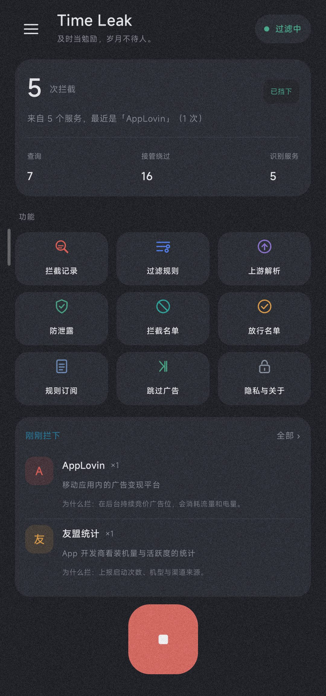
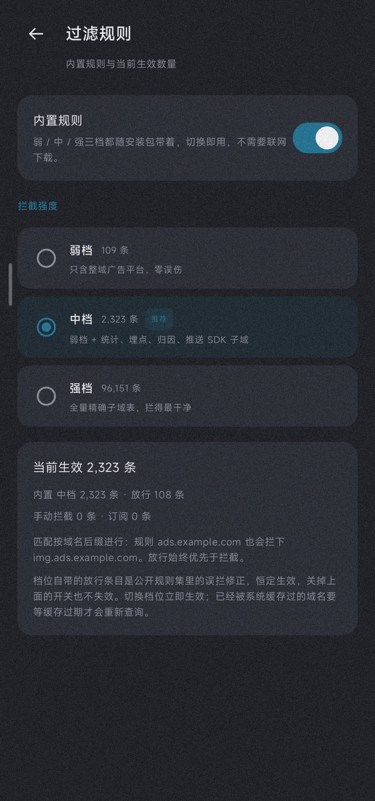
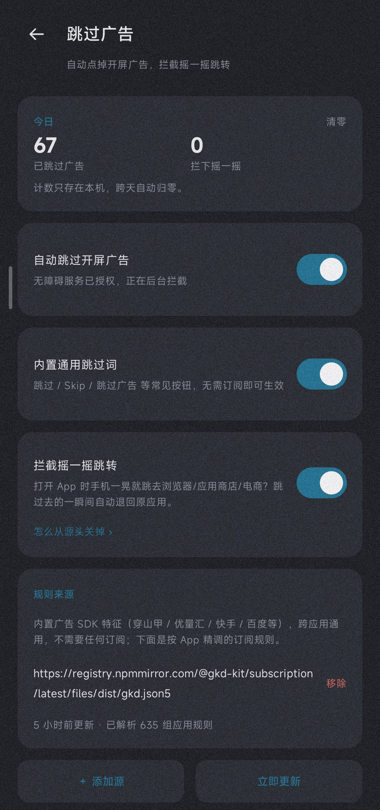
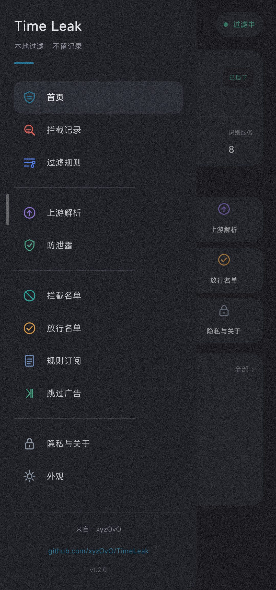
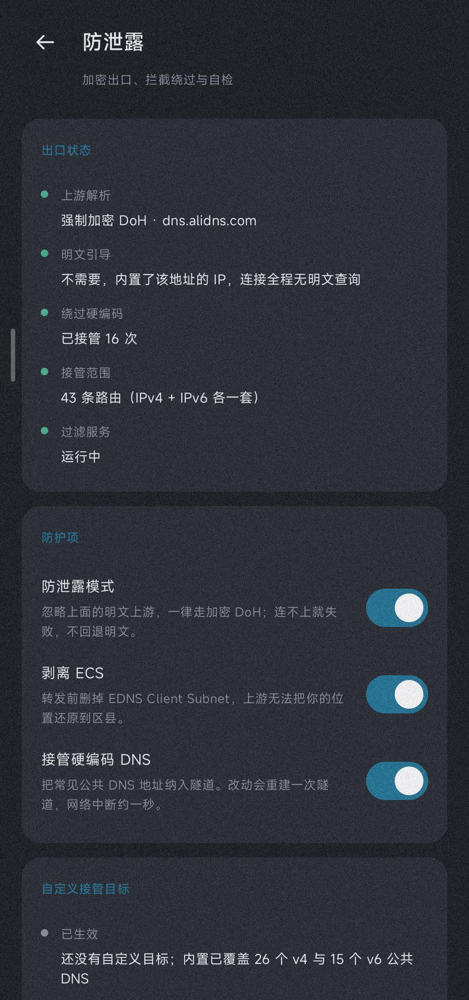

# Time Leak

**Lightweight DNS-only filtering plus out-of-the-box splash-ad skipping.**
Open-source Android tool · No account · No server · No tracking

> [!WARNING]
> **Time Leak is and will always be free and open source.** If you paid for it anywhere, you were scammed — request a refund immediately. Any paid build is a re-packaged fraud and has nothing to do with this project.

> [!NOTE]
> Licensed under **MIT**; keep the copyright notice when reusing code. This is a **personal Android app** with no affiliation, partnership, or authorization from any ad platform or app store. Platform names are used only to identify sources. The **app UI is Chinese only**; this English README is documentation only.

📲 [Download](#-download) · ✨ [Features](#-features) · 🖼 [Screenshots](#-screenshots) · 🎯 [Rules & Tiers](#-rules--tiers) · 🛠 [Build](#-build) · ❓ [FAQ](#-faq) · 🧩 [How it works](#-how-it-works) · ⚖️ [Privacy & Compliance](#-privacy--compliance) · 📄 [License](#-license)

---

## 📲 Download

> **Requirements**: Android 8.0 (API 26) or above. The APK is a properly signed release build; allow "install from unknown sources" on first install.

- Download `app-release.apk` from **Releases** (signed, install and run).
- Or build it yourself (see [🛠 Build](#-build)).

Two steps after install, or features won't work:

1. **Allow the VPN permission**: enabling filtering shows a "connection request" — accept it. This is how DNS filtering works (DNS only, no full-traffic tunneling).
2. **Enable the accessibility service**: toggle it on the "Skip Ads" page, then enable "Time Leak 跳过广告" in system accessibility settings. Splash-ad skipping depends on it.

> For background uptime: disable battery optimization and whitelist the app for autostart / background run (especially on MIUI / ColorOS / HarmonyOS).

---

## ✨ Features

### 🔎 DNS filtering

| Feature | Description |
|---|---|
| **DNS only** | A VpnService redirects system DNS to local resolution; no full-traffic tunneling, minimal overhead |
| **Local resolve + encrypted upstream** | Domain matching and resolution happen locally; encrypted upstream with ECS stripping by default; no query logs on disk |
| **Three built-in tiers** | Weak / Medium / Strong ship inside the APK; switch in the "Filter Rules" page, no download needed |
| **Anti-misfire allowlist** | Built-in allowlist always wins, so system probes / push domains aren't blocked by accident |
| **Optional subscriptions** | Import public subscriptions (e.g. GKD official) as supplements — not required |
| **Honest status** | When the service is off, VPN isn't granted, or rules are loading, the UI says why |

### ⏭ Splash-ad skipping

| Feature | Description |
|---|---|
| **Out of the box** | Built-in skip-button fingerprints of major ad SDKs (Pangle, GDT, KSAd, Baidu, …) work on install |
| **Online subscription** | Ships one GKD official subscription covering splash-skip rules for hundreds of common apps |
| **Active polling** | Splash ads often render after the launch transition and emit no accessibility event, so the service polls windows actively |
| **Five anti-misfire gates** | Time window resets only on external entry, narrow-control constraint, click de-dup, text whitelist, CTA / deny-word blacklist |
| **Shake landing-page rollback** | Without root we can't block sensors; we only roll back "jumped to browser/store/shop" landing pages, max once per target / 10s |

### 🛡 Leak protection

| Feature | Description |
|---|---|
| **Public DNS via tunnel** | 23 common public DNS servers are added to the tunnel route as `/32`; non-virtual-DNS 53 packets are taken over |
| **Cleartext DNS takeover** | Non-virtual-DNS 53 packets are taken over; 443 / 853 are dropped to prevent bypass |
| **Self-built DoH socket** | DoH uses a hand-built socket for SNI + cert validation, bypassing system resolution to avoid local DNS leaks |
| **Private DNS avoidance** | Reads the system "Private DNS" state and avoids conflicting with it |

### 🔄 In-app updates

| Feature | Description |
|---|---|
| **Manual check** | Triggered from "Check for updates" in the side drawer or the button at the bottom of the "Privacy & About" page; only connects when you tap, never in the background |
| **Multi-source fallback** | Version info is fetched concurrently from `update.json` in the repo (raw / jsDelivr) and the GitHub Releases API, then the highest version wins; downloads retry across mirrors |
| **Signature check** | The downloaded APK's signature is compared with the installed one before installing; a mismatch blocks it, keeping out repackaged unofficial builds |
| **You decide** | Once downloaded, the system installer takes over — you confirm the install |

> Maintainers releasing a new version should sync three places: ① `versionCode` / `versionName` in `app/build.gradle.kts`, ② `version` / `notes` in the repo-root `update.json`, ③ replace `app-release.apk` and update the Release. If they disagree, the app picks the highest version so an update is never missed.

---

## 🖼 Screenshots

| Home | Filter Rules (tiers) | Skip Ads |
|---|---|---|
|  |  |  |

| Drawer (GitHub entry) | Leak protection |
|---|---|
|  |  |

---

## 🎯 Rules & Tiers

Built-in rules come in **Weak / Medium / Strong** tiers, all inside the APK; switch in the "Filter Rules" page. Subscriptions are supplements, not required.

| Tier | Block rules | Allow rules | Use for |
|---|---|---|---|
| Weak | 109 | 110 | Only the most annoying ads; almost no false blocks |
| Medium | 2,324 | 110 | Daily recommendation; covers most ads & trackers |
| Strong | 96,151 | 110 | Aggressive; may break niche apps, allowlist as needed |

> On a false block, add the domain to the allowlist on the "Filter Rules" page, or drop to a lower tier.

The default subscription is a single GKD official feed (`@gkd-kit/subscription` dist) covering splash-skip rules for hundreds of common apps. You can add other sources; updates happen only when you tap, never in the background.

---

## 🛠 Build

Requires **JDK 17** and **Android SDK** (compileSdk 35).

```bash
# Standard (needs to fetch the Gradle wrapper)
./gradlew assembleRelease

# If the wrapper can't download, use a local Gradle 8.9 offline
JAVA_HOME=/path/to/jdk17 gradle assembleRelease --offline --no-daemon
```

Output: `app/build/outputs/apk/release/app-release.apk`. The repo's release builds use a fixed signing key, so upgrades are direct overwrite installs.

---

## ❓ FAQ

**Q: No internet after enabling filtering?**
A: Confirm the VPN permission is granted. If you set a system "Private DNS", the app reads and avoids it — don't force both. Strong tier is very aggressive and may over-block; switch to Medium or add an allowlist entry.

**Q: Splash skipping doesn't work / keeps mis-clicking?**
A: It needs the accessibility service. In system Settings → Accessibility, confirm "Time Leak 跳过广告" is on. On MIUI / some ROMs, battery saver freezes accessibility (shows bound but does nothing in `dumpsys`); re-enable it in settings and set battery strategy to "Unrestricted".

**Q: Why DNS-only, not a full proxy?**
A: The app's scope is lightweight filtering + splash skipping. DNS-only already covers most ad/tracker domains with minimal overhead and no full-traffic handling. Per-app blocking is reserved as an extension point.

---

## 🧩 How it works

- **DNS-only VpnService**: a `10.225.0.1` tunnel with virtual DNS `10.225.0.2`; system DNS is redirected locally, matched by domain suffix, the rest resolved normally. Virtual DNS and tunnel must be on different addresses or the local route table creates a `scope host` shortcut.
- **Leak protection**: 23 public DNS servers added as `/32` to the tunnel route; non-virtual-DNS 53 packets taken over, 443 / 853 dropped. DoH must build its own socket (`Socket → bind → protect → connect`) for SNI + cert validation; one wrong step and "DoH times out → whole network loses resolution".
- **Splash skipping**: the accessibility service watches window events and actively polls windows for ~12s after an external entry; scanning goes in three rounds — ad-SDK resource names → user coordinates → text whitelist. At most 2 clicks per window and only the same control, text only on narrow + short controls, plus a CTA / deny-word blacklist to avoid misfires.

---

## ⚖️ Privacy & Compliance

- **No disk writes, no uploads, no analytics SDK, no account, no crash reporting, no push, no background sync.** Queried domains are never written to disk, uploaded, or logged.
- Only three integers are persisted: today's query count / block count / bypass count, reset daily.
- Service names and sample domains in the "block log" live in memory only, cleared on app exit, and can be cleared anytime on that page.
- The code is **fully original**; the public portion of built-in rules is taken from **anti-AD (GPL-3.0)** as a domain list only (no code), rights to original authors; the rest is hand-curated. Subscription content belongs to its authors.
- Licensed under **MIT**; platform names and trademarks belong to their respective owners.

---

## 📄 License

[MIT](LICENSE) © 2026 xyzOvO
