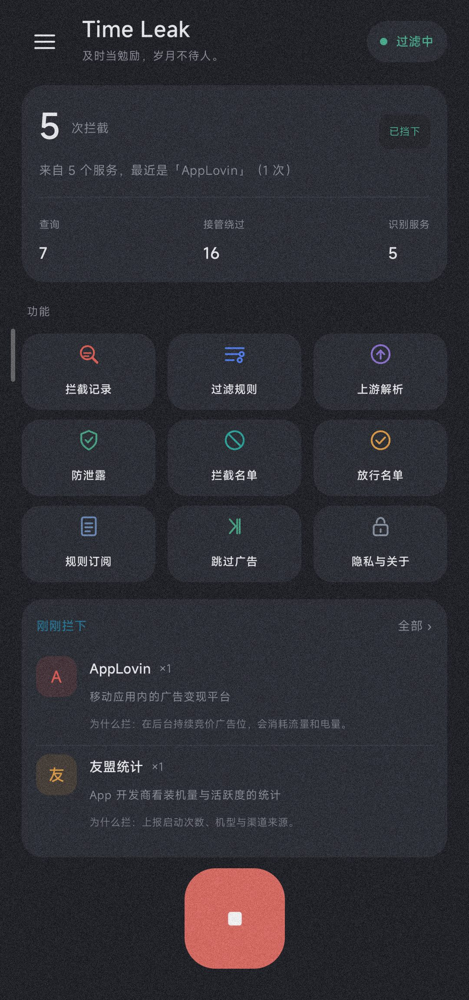
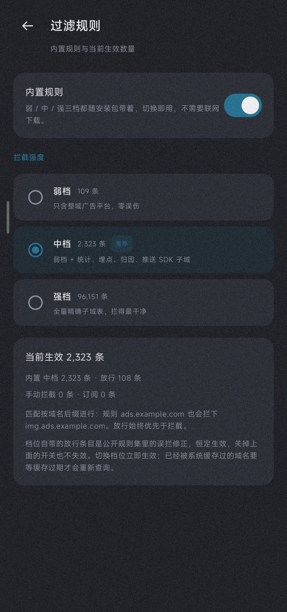
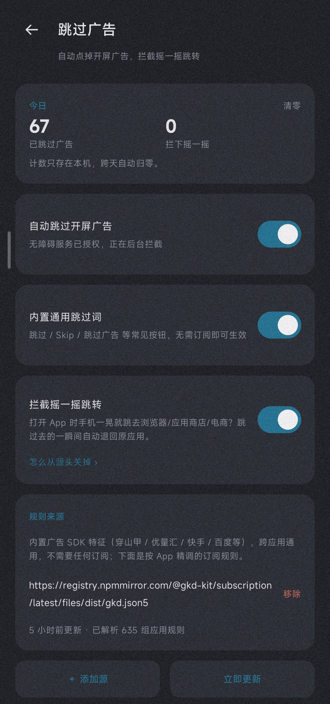
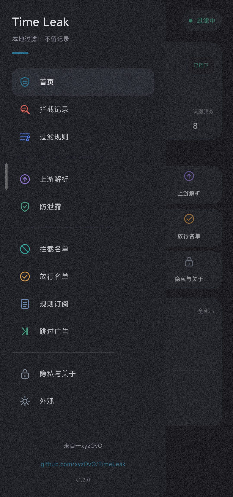
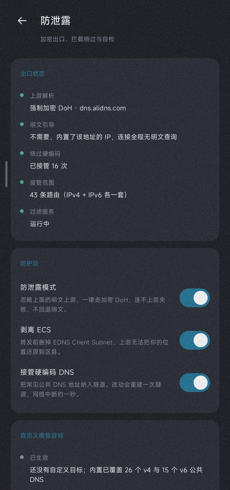

# Time Leak

**只接管 DNS 的轻量过滤，加上开箱即用的开屏广告跳过。**
开源的 Android 工具 · 无账号 · 无服务端 · 无埋点

  

> [!WARNING]
> **Time Leak 永远免费开源。** 如果你是在任何地方「花钱买到」的，说明你被骗了，请立即退款。任何收费版本均为二次打包的诈骗版本，与本项目无关。

> [!NOTE]
> 本项目使用 **MIT 开源协议**，使用代码请保留版权声明；且为 **Android 端个人应用**，与任何广告平台、应用商店无隶属、合作或授权关系，代码中的平台名称仅用于标识来源。App 界面 **仅中文**，英文 README 只是文档翻译。

📲 [下载](#-下载) · ✨ [功能](#-功能) · 🖼 [界面](#-界面) · 🎯 [规则与档位](#-规则与档位) · 🛠 [构建](#-构建) · ❓ [常见问题](#-常见问题) · 🧩 [实现原理](#-实现原理) · ⚖️ [隐私与合规](#️-隐私与合规) · 📄 [许可证](#-许可证)

---

## 📲 下载

> **系统要求**：Android 8.0（API 26）及以上。APK 为正式签名包，首次安装需在系统里允许「安装未知来源应用」。

- **Releases** 下载 `app-release.apk`（正式签名，装上即用）
- 也可以自行构建（见 [🛠 构建](#-构建)）

安装后必做的两步，否则功能不生效：

1. **允许 VPN 权限**：首次开启过滤会弹「连接请求」，点允许。这是 DNS 过滤的工作方式（只接管 DNS，不转发完整流量）。
2. **开启无障碍服务**：在「跳过广告」页点开关，到系统设置里启用「Time Leak 跳过广告」。开屏跳过依赖它。

> 长期后台运行：设置页关闭「电池优化」，并在系统「自启动 / 后台运行」白名单里放行本应用（MIUI / ColorOS / HarmonyOS 尤其需要）。

---

## ✨ 功能

### 🔎 DNS 过滤

| 功能 | 说明 |
|---|---|
| **只接管 DNS** | 通过 VpnService 只把系统 DNS 引到本地解析，不转发应用完整流量，开销极低 |
| **本地解析 + 加密上游** | 在本地完成域名匹配与解析，默认强制加密上游并剥离 ECS，查询记录不落盘 |
| **三档内置规则** | 弱 / 中 / 强三档全部随安装包提供，在「过滤规则」页一键切换，无需联网下载 |
| **防误拦放行** | 内置放行名单恒定生效，避免把系统探测、推送等域名一起拦掉 |
| **可订阅补充** | 支持导入公开订阅（如 GKD 官方订阅）作为补充，不是必需 |
| **状态如实显示** | 服务没在跑、VPN 未授权、规则加载中，界面直接说明原因 |

### ⏭ 开屏广告跳过

| 功能 | 说明 |
|---|---|
| **开箱即用** | 内置主流广告 SDK 的跳过按钮特征（穿山甲、优量汇、快手、百度等），装好即生效 |
| **在线订阅** | 默认带一份 GKD 官方订阅，覆盖数百个常用 App 的开屏跳过规则 |
| **主动轮询** | 开屏广告常在启动过渡后才渲染且常不发无障碍事件，所以改为主动轮询窗口，不错过 |
| **五道防误触闸** | 时间窗只在「从外部进入 App」时重置、窄控件约束、点击去重、文本白名单、CTA / 拒绝词黑名单 |
| **倒计时结束也能点** | 明确信号轮覆盖整个 12 秒开屏窗，倒计时归零或按钮延迟渲染后出现的「跳过 / 关闭」照样识别；四角自适应，不写死右上角 |
| **广告类型识别** | 区分开屏、推广弹窗、信息流、激励视频、付费广告；后三类和任何认不出来的目标一律不点 |
| **点击前二次验证** | 真正下手前重新读一次节点：控件还在、还可见、位置没漂（±16px）、文字没变、窗口仍属于该应用，任何一条不过就放弃并记录原因 |
| **应用级跳过策略** | 预置并可按包名调整，详见下表 |
| **摇一摇落地页回退** | 非 root 拦不住传感器，仅对「跳到浏览器/商店/电商」的落地页做退回，同一目标 10 秒内不重复 |

应用级策略在「跳过广告」与「应用规则」页修改，**用户设置优先于预置和自动归类**：

| 应用 | 默认策略 |
|---|---|
| 淘宝 / 天猫 / 京东 | 只跳过开屏，不处理购物弹窗 |
| 抖音 / 抖音极速版 | 仅明确开屏按钮（不跑订阅推断、不按坐标点） |
| 今日头条 / 腾讯新闻 / 网易新闻 | 开屏 + 允许关闭推广弹窗 |
| 支付宝 / 云闪付 / 建行 / 工行，以及按包名或应用名识别出的银行 / 支付 / 政务类 | 不自动点击 |
| 其它应用 | 开屏 + 带明确广告信号的推广弹窗（默认档） |

推广弹窗只在「明确广告信号 + 该应用允许 + 用户近 900ms 未交互」时处理，每个应用会话最多关一次；一屏出现多个关闭候选会判定为信息流列表并整个放弃。

### 🛡 防泄露

| 功能 | 说明 |
|---|---|
| **公共 DNS 走隧道** | 23 个常见公共 DNS 逐个 `/32` 加进隧道路由，目的地址非虚拟 DNS 的 53 包被接管 |
| **明文 DNS 接管** | 目的非虚拟 DNS 的 53 包接管，443 / 853 直接丢弃，防止绕过 |
| **DoH 自建 socket** | DoH 请求自建 socket 做 SNI 与证书校验，不走系统解析，避免被本地 DNS 泄露 |
| **系统私人 DNS 避让** | 读取系统「私人 DNS」状态并主动避让，不与其冲突 |

### 🔄 应用内更新

| 功能 | 说明 |
|---|---|
| **手动检查** | 侧栏「检查更新」或「隐私与关于」页底部按钮均可触发，仅在你点击时联网，不后台自动查询 |
| **多源容错** | 版本信息并发查询仓库根的 `update.json`（raw / jsDelivr 双地址）与 GitHub Releases API，取最高版本；下载在多个镜像间自动重试 |
| **签名校验** | 安装前比对下载包与已装包的签名，不一致直接拦下，防止二次打包的非官方包 |
| **由你确认** | 下载完成后交给系统安装器，是否安装由你决定 |

> 维护者发新版时需同步三处：① `app/build.gradle.kts` 的 `versionCode` / `versionName`；② 仓库根 `update.json` 的 `version` 与 `notes`；③ 覆盖 `app-release.apk` 并更新 Release。三者版本不一致时 App 会取其中最高的一个，不会漏报。

### 📋 拦截记录里的域名说明

「拦截记录」不只报出域名，还会说明它是谁、做什么、为什么拦。说明分四层，**全部在本地查表生成**：

| 层次 | 内容 | 依据 |
|---|---|---|
| 人工核实 | 常见广告 / 统计服务，写清公司与用途 | 各公司公开资料，卡片里的「资料依据」逐条列出 |
| 厂商域名族 | 腾讯、百度、阿里、微软等注册域下的子域 | 注册域归属为公开信息；具体子域用途标为「未逐条核实」 |
| 上游争议标注 | anti-AD `discretion/` 里的 PCDN、内置加密 DNS、运营商一键登录 | 上游清单。这类**不是广告**，会写明拦它的真实原因和可能的误伤 |
| 名称与形态推断 | 随机命名域名，或含 `ad` / `stat` / `log` 等词根的域名 | 纯字符串判断，明确标注「推断、未核实」，不编造公司名 |

切换档位、开关内置规则、刷新订阅后，卡片里的「命中时来自」和页面底部的「当前生效的规则」会同步；已有卡片保留命中当时的那份名单，不会改口说成一份当时没生效的来源。识别全程不联网、不上传任何查询过的域名。

> 维护者：规则或订阅更新后要重跑一次说明库生成器，让说明跟着新规则走：
> `python tools/explain/build_catalog.py`（`--offline` 可只用缓存的上游清单）。
> 它会重新生成 `GeneratedCatalog.kt`，并输出 `tools/explain/unknown_families.txt`——
> 按规则条数排好、还认不出来的域名家族。核实归属后补进 `tools/explain/seed.tsv`，再跑一次即可。
> **查不到公开归属的随机域名不要硬填公司名**，交给推断层就好。
> 补录时还要留意：宽后缀（如 `yximgs.com`）下面用途不同的子域要单独登记更精确的一条，
> 否则最长后缀匹配会让父域说明盖过去——例如把 `-ad` 广告子域说成内容 CDN。

### 🧩 应用规则

「应用规则」页把逐应用的开关、档位与名单集中在一处：

| 能力 | 说明 |
|---|---|
| **已安装应用列表** | 走 `ACTION_MAIN + CATEGORY_LAUNCHER` 查询，Android 11+ 也能拿到完整桌面应用；支持应用名 / 包名搜索 |
| **按应用开关** | 关掉只影响「要不要动手」，原来选的档位保留，重新打开不用再挑一遍 |
| **按应用策略** | 四档：不自动点击 / 仅明确开屏按钮 / 只跳过开屏 / 开屏 + 推广弹窗 |
| **保护名单** | 最高优先级：不自动点击，连摇一摇回退也不做，适合银行、政务、输入法等 |
| **最近使用** | 记录最近 8 个切到前台的应用，方便直接调规则；只记包名，不记应用内行为 |
| **导入导出** | 单独的「应用规则」JSON：只含包名、档位、关闭与保护名单，不含订阅、DNS 配置与任何记录 |

**按应用 DNS 例外做不出来，也不假装能做。** Time Leak 只接管 DNS，Android 的域名解析由系统统一发起，「这条查询是哪个应用发的」拿不到；按应用断网同理，本版本不接管完整流量、没有默认路由。需要放行某个域名请用「放行名单」，它按域名生效、对所有应用一致，误拦时也是最直接的处理方式。

### 📊 运行概览与状态自检

「运行概览」把八个数字摊开：今日拦截广告数量、今日 DNS 查询数量、开屏广告跳过次数、DNS 拦截次数、当前运行状态、最近一次跳过记录、被放行的域名数量、过滤规则命中来源。计数按自然日分桶，跨天自动归零。

> 口径说明：DNS-only 架构下「今日拦截广告数量」与「DNS 拦截次数」是同一个数（所有被本地应答 NXDOMAIN 的查询）；「被放行的域名数量」只统计命中放行规则的去重域名，上限 5000 条。最近一次跳过只保存时间、包名、规则与判定，不保存按钮文字。

「运行状态自检」覆盖八项：VPN 授权、DNS 服务运行、无障碍授权、无障碍服务是否失效、电池优化、规则加载、订阅更新、网络与 DNS 连通性测试；异常时分别给出重新授权引导、尝试恢复服务、系统设置入口、重新启用提示、关闭电池优化入口、加载错误、失败原因与一键解析测试。

**自动恢复有边界**：30 分钟内最多 3 次、两次间隔至少 60 秒，超预算即停手；VPN 与无障碍未授权时**只提示，绝不自动弹系统授权窗口**；只重启本应用的 DNS 前台服务，不尝试后台启用无障碍服务；用户主动关闭或撤销授权不触发恢复。开机恢复默认关闭，前台通知常驻显示运行中与今日查询 / 拦截数。

### 🔬 安全观察模式、评分匹配与规则回归

跳过广告从「关键词命中即点击」升级为**多条件评分匹配**：广告 SDK 控件 id、明确文案、订阅作用域、窄控件、短文本、四角位置、可点击状态、开屏时间窗、倒计时数字等加权求和；宽控件、长文案、软证据、窗口外场景扣分；业务 CTA / 拒绝词、激励视频、付费广告、信息流、无法确认的目标直接硬否决。

| 置信度 | 行为 |
|---|---|
| 高（≥70） | 广告类型与应用策略都允许才自动点击 |
| 中（45–69） | 只记录，或同一目标短时间内二次出现且证据变强时升级一次 |
| 低（<45） | 不操作 |

**安全观察模式**（核心功能）：只识别规则，不执行点击、不按返回键。每条识别结果展示当前应用、文本、ID、可点击、规则、判定、分数、类型、操作与评分依据；确认规则没问题后再切回自动执行。观察记录**只存内存、退出即清空**，不落盘、不进备份、不上传。

观察页另有**扫描心跳**：每次扫描都留一条摘要（应用、节点数、候选数、窗口类型、结论），不管有没有命中。识别记录为空时，能直接区分「没拿到节点树」「节点树为空」「没有候选」「切应用太快被合并」「策略拦截」，不用再连电脑抓日志。心跳同样只存内存、最多 40 条，只记结构性信息，不含任何界面文字。

点击成功后进入 **2 秒冷却**：同窗口不再点第二个目标，窗口变化才重新判断。节点树扫描同时做了事件过滤、120ms 短时合并、只在窗口 / 内容变化时扫描、深度 12 / 候选 300 / 访问 400 / 超时 120ms 四重上限、短期纯数据快照；`AccessibilityNodeInfo` 在扫描结束时统一释放，绝不跨扫描缓存。

**故障诊断**不靠「运行中」三个字。带明确结论的记录有两条链路：广告没跳过时，「安全观察」页的「为什么没跳过」会写明哪个应用、什么目标、判到哪一档、卡在哪（策略禁用 / 观察模式 / 证据不足 / 冷却中 / 二次验证发现页面已变），最多留 20 条、只存内存；网页打不开时，「运行状态自检」页会给出最近一次拦截的域名、类型与命中来源，并指到「放行名单」和「上游解析」这两个能改的地方。

维护者可在**电脑上离线跑规则回归**，不需要真机：

```bash
python tools/regression/run.py
```

它用 Gradle 缓存里的 Kotlin 编译器把 `DecisionModel.kt` + `DecisionCore.kt`（与 App 运行时同一份决策核心）和 `tools/regression/samples.json` 的典型节点树样本编译成 JVM 字节码，逐条验证是否正确命中、是否误命中正常按钮、是否重复点击、页面切换后是否继续操作、倒计时结束后是否正常点击、是否影响其他应用；报告写入 `tools/regression/report.txt`，失败时退出码非 0。

### 🔐 订阅安全与隐私审计

**公开订阅不无条件信任**。每次更新都要过：来源白名单（新来源须用户确认）→ SHA-256 指纹 → 更新差异预览（新增 / 移除条数与样例）→ 异常规则检查 → 用户确认应用 → 可一键回滚上一版。阻断级异常包括脚本片段、本地文件引用、超长行、空规则、放行规则暴增、条数骤降过半，这类更新不会自动生效；GKD 与 DNS 名单走同一套网关。

「隐私审计」页列出所有本地存储项、联网端点、权限清单、DNS 加密状态与 VPN 流量范围说明；提供配置备份 / 恢复（纯 JSON，只含配置与名单）、运行数据一键清理、全部本地数据清除（二次确认）与订阅完整性校验。备份不含订阅正文、拦截记录、观察记录与统计。

> VPN 只把虚拟 DNS 与公共 DNS 的 `/32` 路由加进隧道，没有默认路由；应用流量完全不经过本服务，因此也无法做「哪个 App 发起的查询」归因。

---

## 🖼 界面

| 首页 | 过滤规则（三档切换） | 跳过广告 |
|---|---|---|
|  |  |  |

| 侧栏（GitHub 入口） | 防泄露 |
|---|---|
|  |  |

---

## 🎯 规则与档位

内置规则分 **弱 / 中 / 强** 三档，全部随安装包提供，在「过滤规则」页切换即可；订阅只是补充，不是必需。

| 档位 | 拦截规则 | 放行规则 | 适用 |
|---|---|---|---|
| 弱 | 109 条 | 110 条 | 只想拦最烦人的广告，几乎不误拦 |
| 中 | 2,324 条 | 110 条 | 日常推荐档，覆盖大部分广告与统计 |
| 强 | 96,151 条 | 110 条 | 激进拦截，可能误拦小众 App，按需放行 |

> 误拦时优先在「过滤规则」页把域名加进放行名单，或切到更低档位。

默认订阅只有一份：GKD 官方订阅（`@gkd-kit/subscription` 的 dist 文件），覆盖数百个常用 App 的开屏跳过规则。你也可以导入其它订阅源做补充；订阅更新只在你手动点击时进行，不会后台自动同步。

---

## 🛠 构建

需要 **JDK 17** 与 **Android SDK**（compileSdk 35）。

```bash
# 标准方式（需要能下载 Gradle wrapper）
./gradlew assembleRelease

# 若 wrapper 无法下载，可改用本地 Gradle 8.9 离线构建
JAVA_HOME=/path/to/jdk17 gradle assembleRelease --offline --no-daemon
```

产物在 `app/build/outputs/apk/release/app-release.apk`。本仓库的正式包使用固定 release 签名，升级时直接覆盖安装即可。

---

## ❓ 常见问题

**Q：开启过滤后上不了网？**
A：先确认 VPN 权限已允许；若你设置了系统「私人 DNS」，本应用会读取并避让，请勿同时强制。强档规则非常激进，可能误拦，先切到中档或加放行。

**Q：跳过广告没反应 / 一直误触？**
A：开屏跳过依赖无障碍服务。在系统设置 → 无障碍 里确认「Time Leak 跳过广告」已开启；MIUI / 部分国产 ROM 的省电策略会冻结无障碍服务（表现为 `dumpsys` 显示已绑定但实际不工作），需在设置里重开一次并把省电策略设为「无限制」。

**Q：为什么只接管 DNS，不做全局代理？**
A：本应用定位是轻量过滤与开屏跳过，只接管 DNS 已能覆盖绝大多数广告与统计域名，且开销极低、不碰完整流量。按应用断流的能力已预留扩展接口。

---

## 🧩 实现原理

- **只接管 DNS 的 VpnService**：建立 `10.225.0.1` 隧道，虚拟 DNS `10.225.0.2`；把系统 DNS 查询引到本地，按域名后缀匹配拦截，其余正常解析。虚拟 DNS 与隧道同址会在本地路由表生成 `scope host` 短路，故二者必须分开。
- **防泄露**：23 个公共 DNS 逐个 `/32` 加进隧道路由；目的地址非虚拟 DNS 的 53 包接管，443 / 853 直接丢弃。DoH 必须自建 socket（`Socket → bind → protect → connect`）再做 SNI 与证书校验，顺序错一步就会「DoH 全超时 → 全网解析挂」。
- **开屏跳过**：无障碍服务监听窗口事件，并在「从外部进入 App」后主动轮询窗口约 12 秒；扫描分三轮——广告 SDK 资源名 → 用户坐标 → 文本白名单。同窗口最多点 2 次且必须同一控件，文本只认窄控件 + 短文本，配合 CTA / 拒绝词黑名单，最大限度避免误触。

---

## ⚖️ 隐私与合规

- **不写盘、不上传、无统计 SDK、无账号、无崩溃上报、无推送、无后台同步。** 查询过的域名不写入磁盘、不上传、不进系统日志。
- 落盘的只有「今日查询数 / 今日拦截数 / 绕过接管数」三个整数，跨天自动归零。
- 「拦截记录」里的服务名和示例域名只在内存里保留，退出应用即清空，可在该页随时清空。
- 内置规则里的公开名单部分取自 **anti-AD（GPL-3.0）**，只取域名清单，不含其代码，权利归原作者；其余为手工整理。订阅内容由原作者提供，权利归各自作者。
- 本项目使用 **MIT 开源协议**；代码中出现的平台名称与商标归各自权利人所有。

---

## 📄 许可证

[MIT](LICENSE) © 2026 xyzOvO
